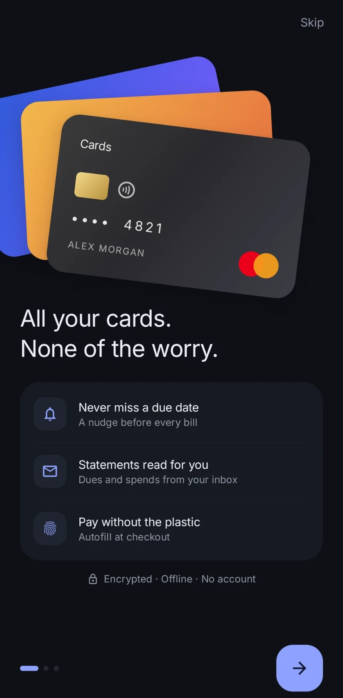
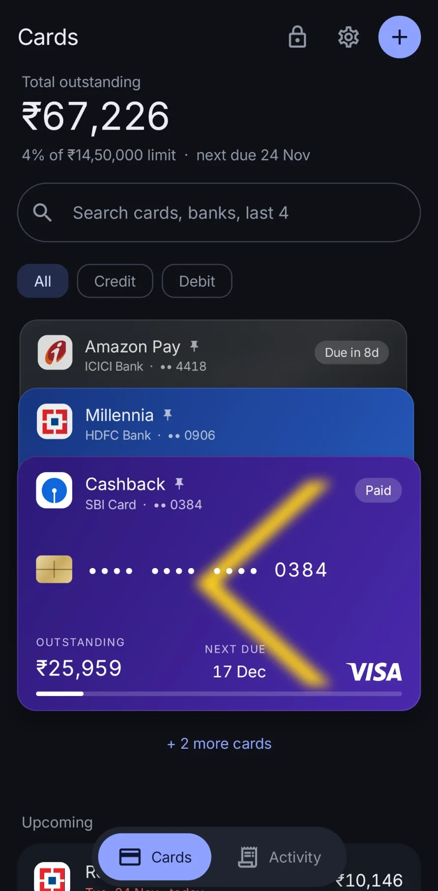
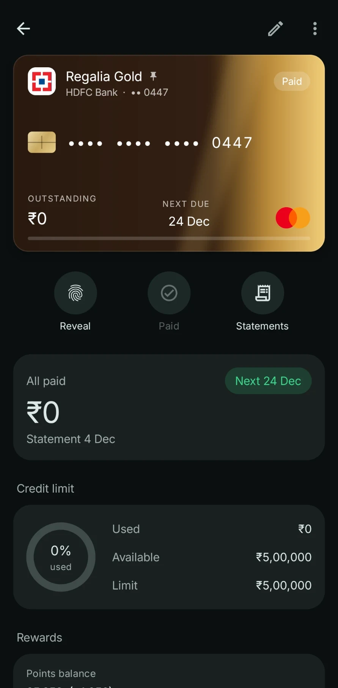
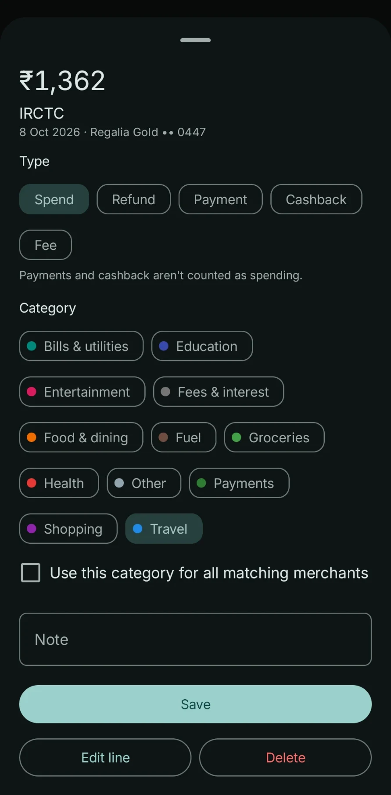
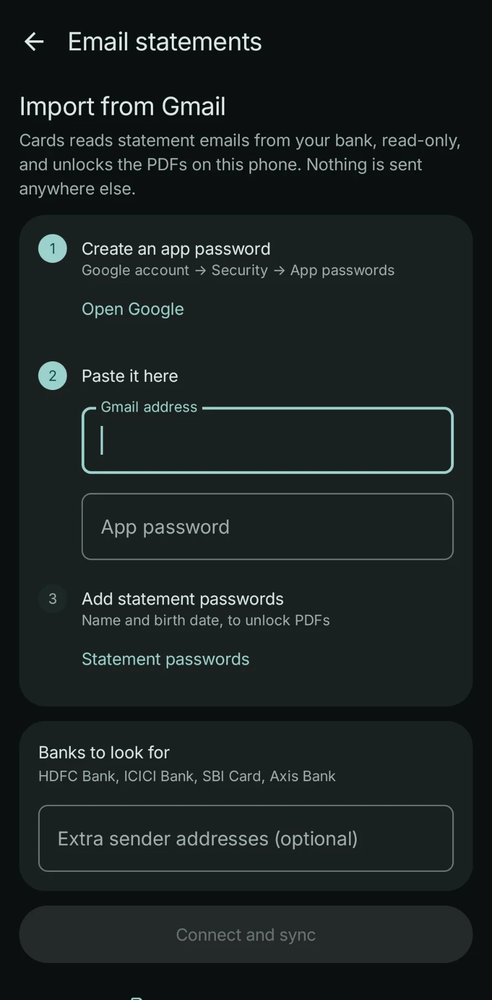

# CardKeep

[](https://github.com/santdas36/CardKeep/releases)
[](#)
[](LICENSE)

A card wallet for Android that keeps everything on your phone. Store your credit, debit and prepaid cards, get reminded before bills are due, and import statements from your email. No account, no cloud, no analytics.

Built for Indian banks and cards first.

<table>
  <tr>
    <td></td>
    <td></td>
    <td></td>
    <td></td>
    <td></td>
  </tr>
</table>

▶ [Watch the demo](docs/demo.mp4)

## Install

[](https://github.com/santdas36/CardKeep/releases/latest)

Download `Cards_<version>.apk` from the latest release and open it on your phone (Android 8.0 or newer). Older versions are on the [Releases](https://github.com/santdas36/CardKeep/releases) page.

## What it does

- Add a card by scanning it, tapping it on the back of the phone (NFC), or typing the number. Bank, network and type are filled in offline.
- Card number, expiry, CVV and name are encrypted. Viewing, copying or autofilling them needs your fingerprint or PIN.
- Autofill card details at checkout in other apps.
- Due date reminders for credit cards, as many days ahead as you like.
- Import statements from Gmail (optional, uses an app password). PDFs are unlocked and read on the phone.
- Spending from imported statements, by category.
- Encrypted backup to a file you keep.
- App lock, no screenshots, and Android cloud backup turned off.

The only network access is reading statement emails from your own mailbox, and only if you set it up.

## Building

You need JDK 17, the Android SDK (platform 36) and Gradle 8.14.3. There's no Gradle wrapper in the repo yet.

```sh
gradle :app:assembleDebug        # debug build (app.cardkeep.debug, installs next to release)
gradle :app:assembleRelease      # release build
gradle :app:testReleaseUnitTest  # tests
```

Release builds are signed if a `keystore.properties` file (git-ignored) exists at the repo root:

```properties
storeFile=release.jks
storePassword=...
keyAlias=...
keyPassword=...
```

Versions: `versionCode` is the git commit count, `versionName` is set by hand in `app/build.gradle.kts`.

To release, bump `versionName` and push to main: the "Build and release APK" action builds the signed APK and publishes it. You can also run it by hand from the Actions tab. It needs the signing secrets listed at the top of [`release.yml`](.github/workflows/release.yml).

### Code layout

```
app/src/main/java/app/cardkeep/
  autofill/    autofill service
  capture/     NFC reader, camera text parsing
  data/        Room database, migrations, backup
  domain/      billing cycles, banks, BIN lookup
  ingest/      Gmail sync, PDF unlock, statement parsers
  reminders/   alarms and notifications
  security/    Keystore keys, vault, biometric prompt
  ui/          Compose screens, card art
```

Kotlin, Jetpack Compose (Material 3), Room + SQLCipher, WorkManager, CameraX + ML Kit, PDFBox-Android, JavaMail.

## Contributing

Issues and PRs are welcome. A few rules:

- Never commit real card numbers, statements, PDFs or passwords. Tests use made-up data.
- No new network access, analytics or tracking.
- Database changes need a migration in `data/AppDatabase.kt` and the generated schema from `app/schemas/`.
- New statement parsers go in `ingest/` with a test in `ParserTest`.

### Card art

Card designs live in [`ui/CardArt.kt`](app/src/main/java/app/cardkeep/ui/CardArt.kt), one entry per card:

```kotlin
CardArt(
    "hdfc_millennia",                 // id: bank_card
    HDFC,                             // bank, as named in domain/Issuers.kt
    "Millennia",                      // display name
    listOf(0xFF1A3A8C, 0xFF2D66D4),   // background gradient
    Motif.SHEEN,                      // pattern
    listOf(0xFF9CC0FF),               // pattern colours
    listOf("millennia"),              // nickname words that pick this design
    // optional: light = true for light cards, x/y to move the pattern, horizontal = true
),
```

See the `Motif` enum for the available patterns. Match the card's colours and pattern, but leave out logos, names and network marks. In the PR, say which card it's based on; please don't attach card images.

## Credits

- BIN data from [binlist-data](https://github.com/iannuttall/binlist-data) (Ian Nuttall) and [bin-list-data](https://github.com/venelinkochev/bin-list-data) (Venelin Kochev), CC BY 4.0. See [`third_party/`](third_party/).
- Inter typeface, SIL Open Font License.
- Bank and card names belong to their owners. CardKeep isn't affiliated with any bank or card network.

## License

[GPL-3.0](LICENSE)
